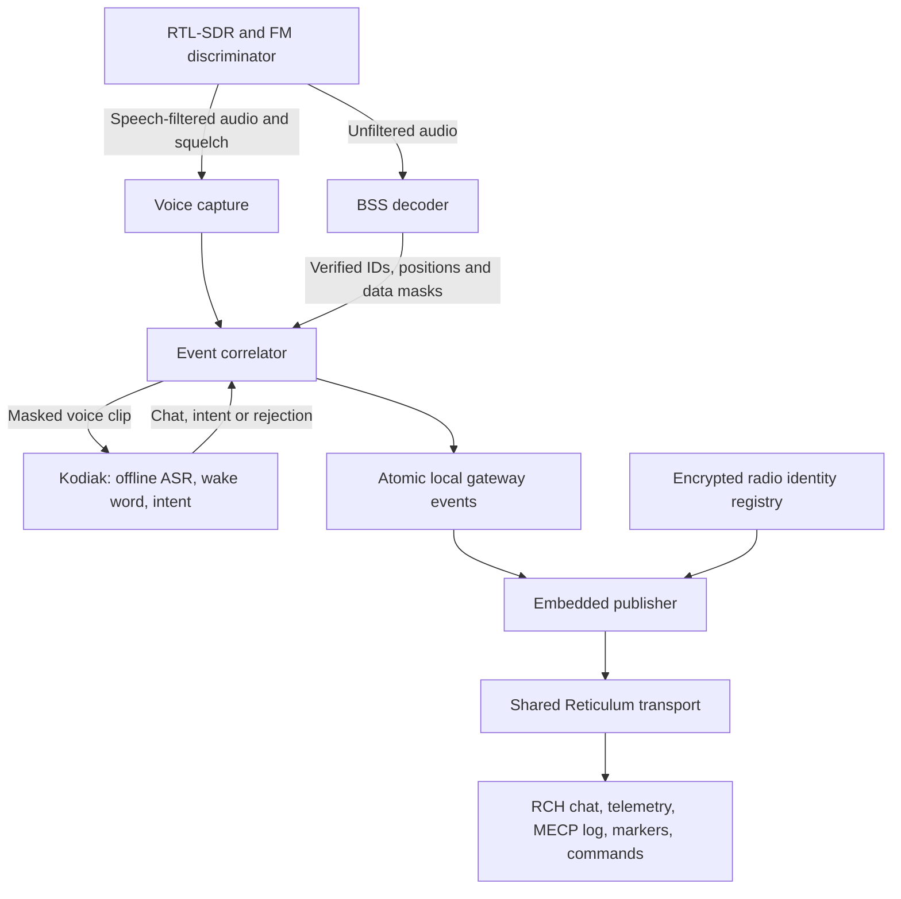

# R3AKT Sigil gateway architecture

The SDR owner numbers 20 ms blocks on a common sample clock and timestamps each block from the USB read that delivered it. Voice capture and the BSS modem consume bounded queues independently. The reader uses nonblocking enqueue. I/Q dropped on USB skips the lost block numbers, so both lanes see the same discontinuity as when a queue is full. A discontinuity invalidates affected attribution windows. Drop totals are logged at most once a minute while blocks are lost, and again at exit. The event worker waits for BSS coverage before submitting masked voice audio to a separate inference thread. Position events are eligible for publication as soon as the packet checksum and location validate. Inference errors are recorded locally while BSS continues.

Failures that affect one item are recorded as `processing_failure` events and the gateway keeps running: a recognizer panic on one clip (the model is reloaded for the next), or a BSS event, diagnostic or `--bss-capture` write that fails. Failures that leave the gateway unable to work stop the receiver, and the process exits with an error: a panic in the voice, BSS or event worker, a BSS lane that ends with an error, recognizer panics on three consecutive clips, or a publisher panic.

Correlation uses the speech interval and the trailing BSS packet’s sample coordinates. It requires the same RF activity or a packet that starts within the trailing-ID gap after the carrier: 3 s by default (`[processing].trailing_id_gap_ms`), because a VR-N76 keys up again 1–2.5 s after the voice to send its BSS packet. Another transmission inside that gap makes the attribution ambiguous. A packet inside the speaker's own carrier (starting within 300 ms of its end) takes precedence over packets in later, separate bursts, such as another radio's periodic beacon. It waits through the configured correlation window for competing voice or BSS evidence. Missing, incomplete and ambiguous attribution stays in local `sdr.gateway.v1` events with a reason. With `[identity].unidentified_sender`, speech with a missing identifier is published from a separate gateway identity that belongs to no radio; ambiguous and incomplete attribution is never published. Decoder repetitions can help attribution without duplicating a position event. WAV replays produce local-only events.

Each allowed normalized BSS ID maps to a Reticulum identity and its standard `lxmf.delivery` destination in the registry database `radios.sqlite3`. The identity is either generated by Sigil or imported from the operator, for example their Sideband or REM identity, so RCH attributes the radio's messages to that address. A CRC proves frame integrity. BSS remains unauthenticated, including if a transmitter sends an allowlisted name. The registry’s random keys authenticate the gateway-managed LXMF sender to RCH. A registry file lock prevents two gateway instances from using the registry at once. Private keys are sealed with XChaCha20-Poly1305 under an Argon2id key derived from the operator’s passphrase and the registry salt. The `radios` table holds display names, delivery addresses, identity source, and the latest received position.

Back up `radios.sqlite3` after stopping the gateway; it holds the salt, every sealed key and the radio table. To restore or migrate, point the new gateway at a copy and use the same passphrase. Back up the Fabric storage and event directory as well to recover pending work and delivery history. Leave a corrupted key in place and restore it from backup. A registered radio whose key is missing also requires recovery from the backup.

The publisher registers a delivery destination for each allowed radio on one `Arc<Transport>`. It wraps those destinations with the Fabric `InProcessBackend` and signs each event with the selected key. It announces radio names and requests the configured hub’s path over TCP. The journal considers live events recorded since activation. Before dispatch, Fabric stores the signed wire with the stable event ID. It retries the same signed message on bounded backoff and keeps pending records across restarts. Each transport call is time-limited, and a call that times out is deferred like any other failed attempt. A delivery proof is matched on the next poll without sending the message again. The log shows the backlog counts when they change. Local journals distinguish queued, awaiting proof, confirmed transport delivery, policy rejection, expiry and events that have no chat or telemetry to send. The expiry policy is seven days.

RCH’s current ordinary-chat fallback runs only when it finds no telemetry envelope. The gateway sends a chat message and a separate position message from the same LXMF source. The `0x02` field is encoded exactly as REM encodes a position (`reticulum_mobile` `telemeter::encode_position`): `r3akt-map-core`'s `telemetry_encode::encode` with the time and location sensors. Readings BSS does not carry (accuracy always, altitude, speed and bearing when absent) are 0, as in REM. BSS speed is already km/h, the Telemeter wire unit. BSS provides no absolute UTC fix timestamp, so both times are the gateway’s reception time.

The dependency pins follow Fabric commit `008bf9e1cbc2b3f6859abf21f64dfdb87be8621f` and REM’s `r3akt-map-core` pin at RCH `82f72e97326e7a6d341456c4ce88ca94240369ca`. [Fabric backend](https://github.com/FreeTAKTeam/LXMF-rs/blob/008bf9e1cbc2b3f6859abf21f64dfdb87be8621f/crates/libs/lxmf-runtime/src/config.rs) · [RCH receive path](https://github.com/FreeTAKTeam/Reticulum-Community-Hub/blob/6827b11b9452a71181f806786b2b448b278a0bf0/crates/r3akt-transport-rns/src/direct_lxmf.rs) · [Telemeter validator](https://github.com/FreeTAKTeam/Reticulum-Community-Hub/blob/82f72e97326e7a6d341456c4ce88ca94240369ca/crates/r3akt-map-core/src/telemetry.rs)

Kodiak returns chat, a validated intent or a structured rejection for each clip; see [docs/kodiak.md](kodiak.md). The gateway never acts on a rejection. It publishes an intent only as an RCH field-9 command from the radio's own identity, so RCH's dispatcher and authorization decide its effect. Contact markers need a GPS fix: the current BSS fix, or else the radio's last valid fix. MECP reports carry that fix as field `0x02` telemetry in the same message when there is one, and are sent without it otherwise. Clock-direction contacts also need a verified compass heading. A BSS ID proves nothing about who transmitted, so enable RCH capability checks before publishing intents to a live hub.
