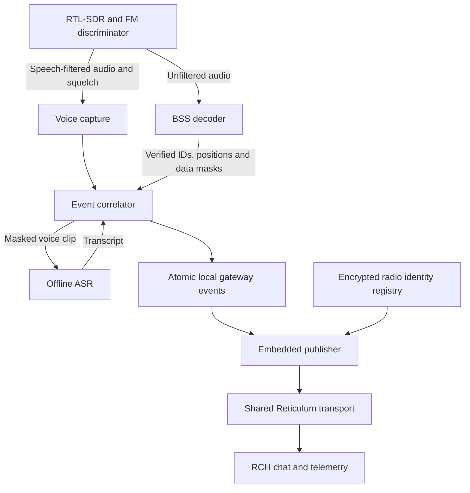

# R3AKT Sigil gateway architecture

The SDR owner numbers 20 ms blocks on a common sample clock. Voice capture and the BSS modem consume bounded queues independently. The reader uses nonblocking enqueue, and a discontinuity invalidates affected attribution windows. The event worker waits for BSS coverage before submitting masked voice audio to a separate inference thread. Position events are eligible for publication as soon as the packet checksum and location validate. Inference errors are recorded locally while BSS continues.

Correlation uses the speech interval and the trailing BSS packet’s sample coordinates. It requires the same RF activity or a gap of at most 300 ms after the carrier. It waits through the configured correlation window for competing voice or BSS evidence. Missing, incomplete and ambiguous attribution stays in local `sdr.gateway.v1` events with a reason. Decoder repetitions can help attribution without duplicating a position event. WAV replays produce local-only events.

Each allowed normalized BSS ID maps to a random Reticulum keypair and a standard `lxmf.delivery` destination. A CRC proves frame integrity. BSS remains unauthenticated, including if a transmitter sends an allowlisted name. The registry’s random keys authenticate the gateway-managed LXMF sender to RCH. A registry file lock and exclusive key creation prevent two gateway instances from regenerating a radio key. Encrypted key files use XChaCha20-Poly1305 with an Argon2id key derived from the operator’s passphrase and registry salt. The public JSON metadata contains display names, delivery hashes and the latest received position.

Back up the identity directory as a unit after stopping the gateway. Keep `salt.bin`, the encrypted `.identity` files and the metadata together. To restore or migrate, point the new gateway at a copy and use the same passphrase. Back up the Fabric storage and event directory as well to recover pending work and delivery history. Leave a corrupted key in place and restore it from backup. A missing key with existing metadata requires recovery from the backup.

The publisher registers a delivery destination for each allowed radio on one `Arc<Transport>`. It wraps those destinations with the Fabric `InProcessBackend` and signs each event with the selected key. It announces radio names and requests the configured hub’s path over TCP. The journal considers live events recorded since activation. Before dispatch, Fabric stores the signed wire with the stable event ID. It retries the same signed message on bounded backoff and keeps pending records across restarts. Local journals distinguish queued, awaiting proof, confirmed transport delivery, policy rejection, expiry and events that have no chat or telemetry to send. The expiry policy is seven days.

RCH’s current ordinary-chat fallback runs only when it finds no telemetry envelope. The gateway sends a chat message and a separate position message from the same LXMF source. The `0x02` field reuses `r3akt-map-core` time and Information sensors and RCH’s named location projection. This receiver profile omits unavailable readings, including GPS accuracy. It keeps measured altitude, km/h and bearing when present. BSS provides no absolute UTC fix timestamp, so the timestamp is the gateway’s reception time. RCH keys the map peer by the LXMF delivery destination and uses the Information sensor for its display name. This named location profile targets RCH.

The dependency pins follow Fabric commit `008bf9e1cbc2b3f6859abf21f64dfdb87be8621f` and REM’s `r3akt-map-core` pin at RCH `82f72e97326e7a6d341456c4ce88ca94240369ca`. [Fabric backend](https://github.com/FreeTAKTeam/LXMF-rs/blob/008bf9e1cbc2b3f6859abf21f64dfdb87be8621f/crates/libs/lxmf-runtime/src/config.rs) · [RCH receive path](https://github.com/FreeTAKTeam/Reticulum-Community-Hub/blob/6827b11b9452a71181f806786b2b448b278a0bf0/crates/r3akt-transport-rns/src/direct_lxmf.rs) · [Telemeter validator](https://github.com/FreeTAKTeam/Reticulum-Community-Hub/blob/82f72e97326e7a6d341456c4ce88ca94240369ca/crates/r3akt-map-core/src/telemetry.rs)
