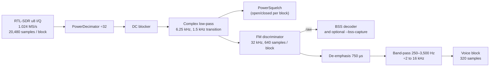
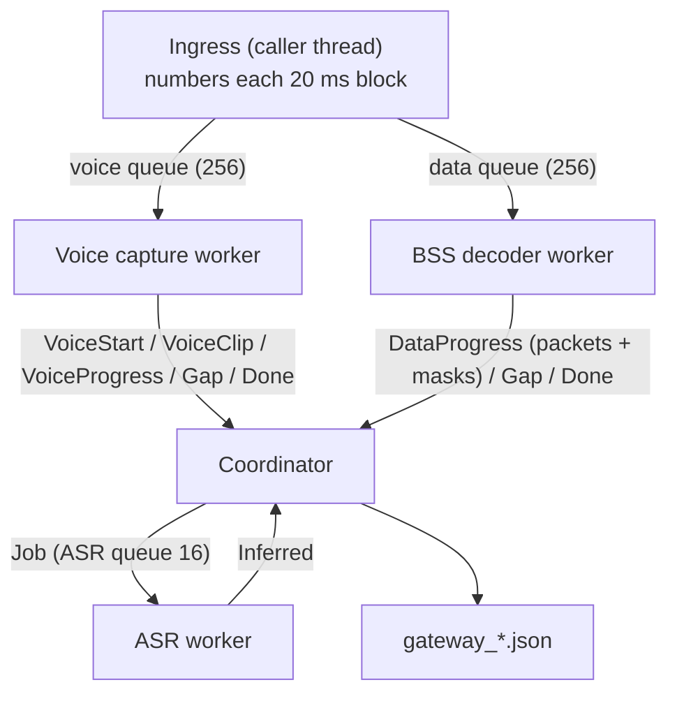
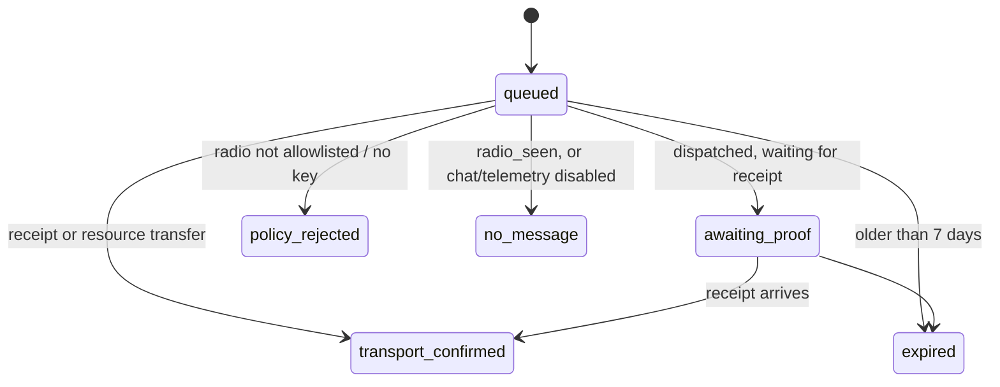

# R3AKT Sigil developer guide

This guide explains how the code works, for people changing it. For installing and running the gateway, see the [README](../README.md). For design decisions about correlation, identity and RCH compatibility, see the [gateway architecture](architecture.md).

## What the program does

`r3akt-sigil` is a single Rust binary (edition 2024, toolchain 1.96.0, `unsafe_code = "forbid"`). It:

1. Tunes a USB RTL-SDR to one analog narrowband FM channel. The default is 435.9950 MHz.
2. Demodulates FM and splits the discriminator output into two paths: speech-band voice audio and unfiltered audio for the data modem.
3. Cuts voice into clips by squelch and transcribes each clip offline with whisper.cpp or, optionally, NVIDIA Parakeet TDT v2 through Sherpa-ONNX.
4. Decodes BSS packets (Bell 202 AFSK, HDLC, CRC-16/X.25) that radios such as the VR-N76 send on PTT release. The packets carry a sender ID and, optionally, a GPS position.
5. Attributes each transcript to the radio whose BSS ID trails it. It writes every result as an atomic JSON event on disk.
6. Optionally publishes the events to a Reticulum Community Hub (RCH) over LXMF. Each allowlisted radio gets its own persistent, encrypted Reticulum identity.

## Repository layout

| Path | Purpose |
|---|---|
| `src/main.rs` | CLI (clap), subcommand dispatch, the `listen` loop wiring |
| `src/radio.rs` | RTL-SDR setup and the NFM DSP chain, squelch calibration, power monitor |
| `src/capture.rs` | Squelch-driven voice clip state machine |
| `src/processing.rs` | Multi-threaded pipeline: ingress, voice and BSS workers, ASR worker, event coordinator, BSS masking |
| `src/bss.rs` | AFSK demodulation, HDLC framing, CRC check, BSS TLV parsing, de-duplication, diagnostics |
| `src/correlation.rs` | `sdr.gateway.v1` event model, radio ID normalization, trailing-ID attribution |
| `src/transcription.rs` | Whisper and Parakeet recognizer backends |
| `src/audio.rs` | WAV read, downmix, FFT resampling to 16 kHz, WAV write |
| `src/output.rs` | Output directory, atomic JSON and WAV writes, console logging |
| `src/replay.rs` | `gateway-wav`: replays a discriminator capture through the full pipeline |
| `src/config.rs` | `gateway.toml` schema and validation |
| `src/identity.rs` | Encrypted per-radio Reticulum identity registry |
| `src/publisher.rs` | Embedded LXMF publisher with a persistent delivery journal |
| `src/telemetry.rs` | Builds the LXMF telemetry field (`0x02`) for RCH map positions |
| `send_lxmf.py`, `test_send_lxmf.py` | Legacy standalone publisher using Fabric's HTTP API, with its tests |
| `gateway.example.toml` | Template for embedded-gateway settings |
| `lxmf.toml` | Settings for the legacy Python publisher |
| `scripts/package-*.{ps1,sh}` | Release bundle scripts |
| `docs/architecture.md` | Gateway architecture notes, shipped in release bundles |
| `models/`, `transcripts/`, `data/`, `dist/`, `target/` | Local, git-ignored: models, outputs, runtime state, bundles, build output |

## Command-line reference

Global options apply to every subcommand.

| Option | Default | Meaning |
|---|---|---|
| `--backend whisper\|parakeet` | `whisper` | ASR backend. `parakeet` exists only in builds with `--features parakeet`. |
| `--model PATH` | `models/ggml-base.en.bin` or `models/sherpa-onnx-nemo-parakeet-tdt-0.6b-v2-int8` | Whisper model file or Parakeet model directory. The default is relative to the working directory. |
| `--frequency-hz N` | `435995000` | Tuned frequency. In WAV modes it only labels output. |
| `--output-dir DIR` | `transcripts` | Destination for all JSON and WAV output |
| `--save-wav` | off | Save each voice clip as a 16 kHz mono 16-bit WAV |

Subcommands:

| Command | What it does |
|---|---|
| `listen` | Live receive. Options: `--device-index`, `--gain-db` (29.7), `--squelch-dbfs` (auto-calibrated if omitted), `--ppm`, `--monitor-power`, `--config FILE`, `--bss` or `--bss-only`, `--bss-diagnostics`, `--bss-capture WAV`, `--correlation-timeout-ms` (200–30000). |
| `wav INPUT` | Transcribe one WAV file (8–192 kHz, at most 5 minutes). This bypasses the pipeline and BSS. |
| `bss-wav INPUT` | Decode BSS from a demodulated-audio WAV. It resamples to 16 kHz when Yodel does not support the input rate. |
| `gateway-wav INPUT --rf-open START:END ...` | Replay a 32 kHz `--bss-capture` file through the voice, BSS, correlation and ASR stages. Each `--rf-open` gives a squelch-open interval in ms. |

The BSS decoder runs in `listen` when any of these holds: `--bss`, `--bss-only`, `[rch].enabled`, or a `--config` was given with `[processing].parallel_voice_bss = true`, which is the default. `--bss-only` skips loading an ASR model.

## Signal chain

All rates are fixed constants in `radio.rs` and `capture.rs`. The whole pipeline runs on a common 20 ms block clock.



- **Squelch calibration.** Without `--squelch-dbfs`, the receiver discards 5 settling blocks. It then measures the remaining blocks of the first second and sets the threshold to the median level plus 8 dB, clamped to −120…0 dBFS. With a manual threshold it only skips the 5 settling blocks.
- **Short USB reads** are reassembled into whole 40,960-byte blocks so that I/Q pairing is preserved.
- **`--monitor-power`** logs the peak channel level, the threshold, and whether squelch opened, once per second.

## Voice capture (`capture.rs`)

`Capture::push(open, frame, at)` is a per-block state machine:

| Constant | Value | Effect |
|---|---|---|
| `ATTACK_FRAMES` | 2 | Two consecutive open blocks start a clip. The first open block's time becomes `started_at`. |
| `PREROLL_FRAMES` | 3 | Up to 3 earlier blocks are prepended to the clip. |
| `HANGOVER_FRAMES` | 15 (300 ms) | A clip ends after 300 ms of continuous closed squelch. Shorter fades stay in the clip as silence, so hiss never reaches the ASR. |
| `MIN_OPEN_FRAMES` | 5 (100 ms) | Shorter clips are discarded. |
| `MAX_SAMPLES` | 30 s | A continuous carrier is split into clips of at most 30 s. |

On completion, trailing silent blocks are trimmed except one. `Clip` records the wall-clock start and end, and three block indices: `first_frame` (start of audio including preroll), `signal_first_frame` and `signal_last_frame`. Correlation and masking work only on these block indices, never on wall-clock time.

## Processing pipeline (`processing.rs`)

`processing::run` is shared by `listen` and `gateway-wav`. It starts scoped threads connected by bounded `sync_channel`s:



**Back-pressure policy.** In live mode the ingress uses `try_send`. When a worker falls behind, blocks are dropped rather than stalling the USB reader. The drop counts are logged at exit, and the worker sees a gap in block indices. Replay mode uses blocking `send`, so it never drops.

**Gaps.** A worker that sees a missing index sends `Event::Gap`. The voice worker restarts its capture state at the new index, and the BSS decoder resets its demodulator, NRZI and framer. The coordinator records a `processing_failure` event. Any transcript whose correlation window overlaps a gap becomes `incomplete_audio`.

**The coordinator** is single-threaded and handles each event in three steps:

1. **`event`** updates the watermarks: `voice_through` and `data_through`, the highest block index each lane has fully processed. Every new, non-duplicate BSS packet with a valid sender is persisted immediately as `radio_seen`, or as `position` if it carries a location. Telemetry never waits for ASR.
2. **`dispatch`** releases a completed clip to ASR only after the BSS lane has caught up past the clip's end. Then BSS bursts inside the clip can be masked. It then:
   - zeroes every block inside a BSS mask (packet span ± 3 guard blocks);
   - after the last mask, zeroes blocks below 0.009 RMS, which removes the quiet carrier tail that radios leave open after the AFSK burst;
   - recomputes the audible span and drops the clip if fewer than 5 audible blocks remain. That case is a pure data burst and is logged as "BSS burst excluded from speech recognition".
   - It names the job `voice-<started_at>-<first_frame>` and sends it to ASR with a non-blocking send. A full queue is recorded as a failure.
3. **`settle`** attributes each pending transcript once both watermarks pass `span.end + window`. It writes the event when both text and attribution are known. It also expires history older than `MAX_CLIP_FRAMES + 2 × window`.

Workers run inside `catch_unwind`. A panic in ASR marks the recognizer unavailable for later clips but keeps BSS running.

The run ends when both lanes report `Done` and nothing is waiting or pending. Ctrl+C therefore drains queued clips before exit.

## Attribution rules (`correlation.rs`)

`window = ceil(correlation_timeout_ms / 20)` blocks, 250 by default. `AudioHistory::resolve` picks the BSS packet that **trails** the speech:

- The packet starts no earlier than one block before the audible span ends, and ends within `window` blocks after it.
- The packet starts within 300 ms (15 blocks) after the last RF-open block of the clip.
- The sender normalizes through `radio_id`: trimmed, 1–32 characters of `[A-Za-z0-9_-]` starting alphanumeric, upper-cased. A sender such as `../../R4` is rejected.

The result is one of:

| Result | When |
|---|---|
| `Attribution` | Exactly one normalized ID qualifies |
| `missing_identifier` | No packet qualifies, or BSS is not enabled |
| `ambiguous_identifier` | Two different IDs qualify; another voice clip could also own the packet or overlaps it; or a new voice clip started between this speech and the packet |
| `incomplete_audio` | A dropped-block gap overlaps the window, or the input ended before the window closed |

Leading IDs (BSS sent on PTT press) are deliberately not used.

## BSS decoding (`bss.rs`)

- **Modem.** `yodel` provides the Bell 202 AFSK demodulator (1200 baud, 1200/2200 Hz) and NRZI decoding. The crate implements its own `Framer`, because BSS payloads can be shorter than the AX.25 minimum that Yodel's HDLC layer enforces.
- **Framing.** A frame lies between `0x7E` flags. Seven consecutive ones is an abort. Frames are capped at 4,096 bits. `frame_bytes` removes stuffed bits (LSB-first), requires byte alignment, and checks the little-endian CRC-16/X.25 FCS.
- **Candidates.** Only frames whose first byte is the BSS marker `0x01` are parsed. A frame that also has a valid CRC, or at least 3 preamble flags, produces a voice mask even when its CRC fails. A corrupted burst is still removed from the speech audio.
- **Payload.** After the `0x01` marker, the payload is a sequence of TLVs with the layout `len, type, value[len-1]`:

  | Type | Field |
  |---|---|
  | `0x20` | sender |
  | `0x21` | destination |
  | `0x24` | text |
  | `0x25` | location |
  | `0x27` | location request |
  | `0x28` | call request |
  | other | preserved in `unknown_fields` as hex |

  The special length byte `0x85` is followed by a 2-byte big-endian message ID. An optional VR-N76 5-byte header (`0x8B` plus 4 opaque bytes) before the sender is preserved as `vr_n76_header_hex`.
- **Location.** Latitude and longitude are signed 24-bit big-endian values in units of 1/30,000 degree. An optional 6-byte tail carries altitude (i16 m, `i16::MIN` = unknown), speed (u16 km/h, `0xFFFF` = unknown) and heading (u16 degrees, `0xFFFF` = unknown). Out-of-range or short values keep the raw hex with `encoding: "unresolved"`.
- **De-duplication.** An identical payload within 10 s of audio is not written again. It is still returned with `duplicate: true`, so it can help attribution.
- **Diagnostics.** With `--bss-diagnostics`, rejected candidates are written as `bss-diagnostic_*.json` with the recovered bit string.

## Transcription (`transcription.rs`)

- **Whisper.** CPU only, greedy decoding, English, `no_context`, blank and non-speech tokens suppressed. The model loads lazily on the first clip in `listen`.
- **Parakeet.** Sherpa-ONNX `nemo_transducer`. The model directory needs `encoder.int8.onnx`, `decoder.int8.onnx`, `joiner.int8.onnx` and `tokens.txt`.
- Both backends use up to 4 threads and collapse whitespace in the output.

## Output files

`Output` writes every file through a temporary file plus `sync_all` plus `persist_noclobber`. A file is either complete or absent, and existing files are never overwritten. File names begin `<prefix>_<UTC yyyymmddTHHMMSS.mmmZ>_<frequency_hz>_<random>`.

| File | Schema | Written by |
|---|---|---|
| `<ts>_<hz>_<rand>.json` (+ `.wav`) | Plain transcript: `started_at`, `ended_at`, `transcribed_at`, `frequency_hz`, `source`, `audio_duration_ms`, `text`, `audio_file?` | Every transcribed clip (`Output::transcribe`) |
| `bss_*.json` | `sdr.bss.v1`: `protocol`, `timestamp`, `frequency_hz`, `source`, `audio_sample_offset`, `sample_rate_hz`, `payload_hex`, plus the parsed packet fields | Each new verified BSS packet |
| `bss-diagnostic_*.json` | `sdr.bss.diagnostic.v1`: `error`, `hdlc_bits`, … | Rejected candidates with `--bss-diagnostics` |
| `gateway_*.json` | `sdr.gateway.v1`: `id`, `timestamp`, `frequency_hz`, `source`, `kind`, plus kind-specific fields | Coordinator (see below) |

`sdr.gateway.v1` kinds (`correlation::Kind`, tagged by `kind`):

| `kind` | Fields |
|---|---|
| `radio_seen` | `radio_id`, `display_name` |
| `position` | `radio_id`, `display_name`, `position{latitude, longitude, altitude_m?, speed_kmh?, heading_deg?}` |
| `transcript` | `radio_id?`, `display_name?`, `bss_event_id?`, `unresolved_reason?`, `started_at`, `text`. Blank transcripts are not written. |
| `processing_failure` | `stage` (`voice_capture`, `bss` or `asr`), `detail` |

In `listen`, the coordinator writes `gateway_*.json` even without `--config` or BSS. In that case every transcript carries `unresolved_reason: "missing_identifier"`.

## Gateway configuration (`config.rs`)

`gateway.toml` rejects unknown keys. The registry and Fabric paths are resolved relative to the TOML file's directory.

| Key | Default | Notes |
|---|---|---|
| `[processing].parallel_voice_bss` | `true` | Enables the BSS lane when a config file is given |
| `[processing].correlation_timeout_ms` | `5000` | 200–30000. `--correlation-timeout-ms` overrides it. |
| `[identity].auto_register` | `false` | Create keys for allowlisted radios on first sight |
| `[identity].registry_path` | `data/identities` | |
| `[identity].allowlist` | `[]` | Normalized with `radio_id`. Required when RCH is enabled. |
| `[fabric].tcp_clients` | `[]` | `host:port` Reticulum TCP interfaces. Required when RCH is enabled. |
| `[fabric].local_storage_path` | `data/fabric` | |
| `[rch].enabled` | `false` | Requires `R3AKT_IDENTITY_PASSPHRASE` (at least 16 bytes) in the environment |
| `[rch].destination_hash` | `""` | 32 hex characters: the hub's `lxmf.delivery` hash |
| `[rch].send_chat`, `[rch].send_telemetry` | `true`, `true` | At least one must be `true` |

## Identity registry (`identity.rs`)

Directory contents:

- `registry.lock`: an exclusive file lock held while the registry is open.
- `salt.bin`: 16 random bytes. If it is missing while `.identity` or `.json` files exist, opening fails instead of silently re-keying.
- `transport.identity`: the node identity for the shared Reticulum transport.
- `radio-<ID>.identity`: the encrypted private key, stored as `"R3AKT-ID\x01" ‖ 24-byte nonce ‖ XChaCha20-Poly1305(8-byte BE creation time ‖ 64-byte key)`. The AAD is the format tag plus the slot name, so files cannot be swapped between slots. The key is Argon2id (19 MiB, t=2, p=1) of the passphrase and salt.
- `radio-<ID>.json`: public metadata: `bss_id`, `display_name`, `bss_authenticated: false`, `rns_identity_ref`, `lxmf_destination`, `registered_at`, `last_seen`, `last_position`.

`observe(id, name, …)` returns a key only if `name` normalizes to `id` and `id` is allowlisted. It creates a key only on first sight with `auto_register`. It also checks that the metadata matches the key: same ID, same destination hash, and same creation time. A corrupted or mismatched key is an error and is never regenerated.

## Embedded publisher (`publisher.rs`)

The publisher runs on its own thread inside `listen` when `[rch].enabled`. Every 2 s, or sooner when unparked at shutdown, it:

1. requests a path to the hub every 15 s, and announces each radio's `lxmf.delivery` destination with its display name every 90 s;
2. scans the output directory for `gateway_*.json` events. It considers only events that are `source: live`, timestamped after the journal's `enabled.json` activation time, carry a valid ID, and are tied to a radio. At most 32 due jobs are taken per pass, oldest first.
3. keeps one journal record per event at `data/fabric/<hub-hash>/<event-id>.json`, with the status lifecycle:



Retries back off at `min(3 × 2^attempts, 300)` seconds. Each radio has its own Fabric `LocalPropagation` store (`radio-<ID>.sqlite3`). The signed LXMF message is stored there under the event ID as correlation ID before the first dispatch, so retries resend the same signed wire and never re-sign a new message.

**Message content.**

- A transcript becomes a chat message with the body `Radio: <name>\nFrequency: <MHz>\nTime: <RFC3339>\n\n<text>`.
- A position becomes an empty-content message with field `0x02`. `telemetry::fields` builds it from `r3akt-map-core`'s time and Information sensors plus a named `location` projection with latitude, longitude, timestamp, and altitude, speed and bearing when known. It does not include accuracy. It round-trips the result through RCH's decoder before sending.

## Legacy Python publisher

`send_lxmf.py` (Python 3.11+, standard library only) is the earlier publishing path. It POSTs to a running Fabric or YARA HTTP API at `/api/v1/lxmf-messages/send`. It publishes plain transcript JSON files (and `sdr.bss.v1` files when `forward_bss = true`) as `[sender | MHz | HH:MM:SS]\ntext`.

Its SQLite outbox (`.lxmf-outbox.sqlite3`) tracks jobs through `pending`, `sending`, `accepted`, `rejected`, `ambiguous`, `deferred` and `ignored`. Only failures before the POST are retried automatically. Anything that may have reached Fabric is held for manual review. Do not run it on the same event directory as the embedded publisher.

## Building, testing, packaging

```powershell
cargo build --release --locked                     # Whisper only
cargo build --release --locked --features parakeet # adds Parakeet
cargo test  --release --locked
python -m unittest -v test_send_lxmf
```

Windows needs the MSVC toolchain, CMake, LLVM/libclang (`LIBCLANG_PATH`), and a WinUSB driver on the dongle. Linux needs a C/C++ toolchain, CMake and libclang.

The Rust tests are hardware-free and synthesize their own signals:

| Test | Covers |
|---|---|
| `radio::narrowband_chain_*` | The DSP chain passes an in-channel tone and rejects a carrier 25 kHz off channel |
| `capture::*` | Clip start, fades, hangover, re-arm, spike rejection |
| `bss::*` | TLV and location parsing, VR-N76 header, an end-to-end modulated WAV with de-duplication, CRC failure diagnostics and masking |
| `correlation::*` | Trailing-only attribution, ambiguity, gaps, ID sanitizing |
| `processing::*` | Carrier-tail masking. Telemetry is not blocked by slow ASR, and the trailing ID is attributed end to end. |
| `identity::*` | Distinct keys, lock exclusivity, restart, backup restore, corruption detection |
| `telemetry::*` | RCH decodes a sparse location without a fabricated accuracy |
| `publisher::*` | Loopback Reticulum peer receives signed chat and telemetry from two radio identities. Identities survive a restart. |

`scripts/package-windows.ps1 [-WhisperOnly] [-ModelPath …]` and `scripts/package-linux.sh [model]` build a release and bundle the binary, the runtime DLLs (Parakeet on Windows), `gateway.example.toml`, the README, `docs/architecture.md`, `docs/developer-guide.md`, the license and an optional model into `dist/`.

## Pinned external dependencies

| Dependency | Source and pin |
|---|---|
| SDR DSP and types | `jasonherald/rtl-sdr` @ `4380abf` |
| USB driver | `librtlsdr-rs` 0.3.0 (bundled libusb via `rusb`) |
| LXMF, Fabric runtime, Reticulum transport | `FreeTAKTeam/LXMF-rs` @ `008bf9e` |
| RCH telemetry codec | `r3akt-map-core` from `FreeTAKTeam/Reticulum-Community-Hub` @ `82f72e9` |
| ASR | `whisper-rs` 0.16; `sherpa-onnx` 2.0.2 (optional) |
| AFSK modem | `yodel` 0.2.0 |

## Notes for contributors

- The block index is the single clock for correlation. Keep new timing logic in block indices, not wall-clock timestamps. Live timestamps are taken when a block is processed, not when it was sampled.
- Every on-disk write must stay atomic: use `Output::save_event` or `identity::write_atomic`. The publisher and external tools read the directory concurrently.
- `sdr.*` schema names are a contract with the publisher and downstream tools. Bump the version suffix on incompatible changes.
- BSS is unauthenticated. The allowlist and registry decide only which gateway key signs a message. They do not prove who transmitted it.
- The project folder is not currently a git repository.
