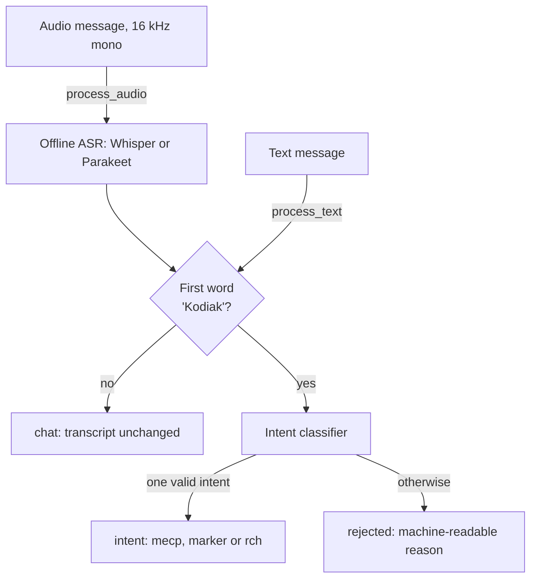

# R3AKT Kodiak in Sigil

Kodiak is a reusable, offline voice-command engine. Sigil passes it each received voice clip and acts on what comes back. Kodiak lives in this workspace for now as four independent packages; [KODIAK_EXTRACTION.md](../KODIAK_EXTRACTION.md) explains how they move to `FreeTAKTeam/R3AKT-Kodiak`.

## Processing sequence



Kodiak transcribes, gates and classifies. It never executes commands, publishes messages, reads hardware, or invents positions, headings or confidence values. The caller decides what to do with each result.

Only the first word decides: a message that does not start with the activation word (or a misheard form of it, below) is chat, even when "Kodiak" appears later ("I saw a kodiak bear", "hey Kodiak, list users"). `process_text` enters the sequence at the activation-word check. RCH can use it to interpret text that arrives from ordinary LXMF clients.

## Packages

| Package | Depends on | Features | Role |
|---|---|---|---|
| `kodiak-core` | `serde`, `serde_json` | none | `KodiakResult` contract, `WakeWord`, `Engine`, `Transcriber` and `IntentClassifier` traits |
| `kodiak-asr` | `kodiak-core` | `whisper` (default), `parakeet` | Recognizers taken from Sigil's former `transcription.rs` |
| `kodiak-intent` | `kodiak-core`, `serde`, `toml` | none | Vocabularies, `DeterministicClassifier`, datasets, examples |
| `kodiak-laya` | `kodiak-core`, `kodiak-intent`, `laya-candle`, `serde_json` | none | Optional `LayaClassifier` (`laya/2`), the `evaluate_laya`, `probe` and `probe_json` examples. Linked into Sigil only with `--features laya`; workspace builds and tests compile it. It depends on Apache-2.0 `laya-candle` (see its `NOTICE`). |

Text-only use needs only `kodiak-core` and `kodiak-intent`, and loads no speech model. `Engine::with_transcriber_loader` loads the speech model on the first audio message and keeps the loader. A failed load is reported for each audio message and retried at most once every 30 s (`ASR_RETRY_INTERVAL`). If the recognizer panics, the panic reaches the caller, and the next audio message discards that recognizer and loads the model again. One `Engine` is `Send + Sync`, and Sigil shares a single engine, and so a single loaded model, across every radio it hears.

The API is synchronous. Recognition and classification are CPU-bound and Sigil runs them on its ASR worker thread; async callers should use a blocking thread pool.

Input bounds:

- Audio longer than `DEFAULT_MAX_AUDIO_SECONDS` (300 s; `Engine::with_max_audio_seconds`) is refused with `KodiakError::InvalidAudio` before recognition.
- A command of more than `DEFAULT_MAX_COMMAND_WORDS` (128; `Engine::with_max_command_words`) words after the activation word is rejected as `invalid_parameter` without being classified. Words are counted as the classifiers tokenize them, so hyphens and other punctuation split words and one long hyphenated "word" cannot bypass the limit. A transcript without the activation word that is longer than this plus one word stays chat, without asking the classifier whether it addresses Kodiak.

## Result contract `kodiak.result.v2`

Every result carries `"schema": "kodiak.result.v2"` and a `type`. Intents and rejections also record the classifier and the version of each vocabulary it used (`"vocabularies":{"contact":"1.3","mecp":"1.9","rch":"1.1"}`, omitted below).

```json
{"schema":"kodiak.result.v2","type":"chat","content":"We need more food at the camp."}

{"schema":"kodiak.result.v2","type":"intent","category":"mecp","intent":"mecp.report",
 "data":{"severity":1,"code":"S02","codes":["S02"],"content":"MECP/1/S02"},
 "transcript":"Kodiak. Urgent. Need Food.","classifier":"deterministic/6"}

{"schema":"kodiak.result.v2","type":"intent","category":"mecp","intent":"mecp.report",
 "data":{"severity":0,"code":"P01","codes":["P01","M01"],"content":"MECP/0/P01 M01 4pax @1430",
         "parameters":{"pax":4,"timestamp":"1430"}},
 "transcript":"Kodiak mayday trapped, injured, four people, time 1430 hours.","classifier":"deterministic/6"}

{"schema":"kodiak.result.v2","type":"intent","category":"marker","intent":"contact.report",
 "data":{"affiliation":"hostile","direction_type":"relative_clock","relative_bearing_deg":180,"distance_m":300},
 "transcript":"Kodiak hostile, 300 meters, 6 o'clock.","classifier":"deterministic/6"}

{"schema":"kodiak.result.v2","type":"intent","category":"rch","intent":"mission.users","data":{},
 "transcript":"Kodiak list users.","classifier":"deterministic/6"}

{"schema":"kodiak.result.v2","type":"rejected","category":"marker","reason":"cancelled",
 "detail":"the contact report is negated or cancelled by \"no\"",
 "transcript":"Kodiak hostile 300 meters 6 o'clock, no, cancel","classifier":"deterministic/6"}
```

- **Changes from `kodiak.result.v1`:** additions only. MECP `data` gains `codes` (every event, in spoken order; `code` stays the first one) and `parameters`; rejections gain the reasons `contradictory` and `cancelled`; results gain `vocabularies`. Version 1 documents still decode (a v1 report becomes `codes: [code]`); results are always written as version 2.
- **Rejection reasons:** `no_intent` (unrecognized command), `missing_parameter`, `ambiguous` (more than one reading), `invalid_parameter` (a value outside the vocabulary or the protocol limits), `contradictory` (two values for one thing, or events that exclude each other), `cancelled` (a negation such as "don't", "no" or "cancel") and `unsupported_command`. A rejection is never executable.
- **MECP parameters:** only values the operator spoke: `pax`, `coordinates` (`latitude`, `longitude`), `references`, `eta_minutes`, `language`, `timestamp` (`HHMM`), `callsign` and `text`. Kodiak never fills one in; metadata such as the radio's own position is added by the caller, outside the result.
- **Contact directions:** a contact report has either `direction_type: relative_clock` with `relative_bearing_deg` (12 o'clock is 0°, and half hours add 15°), or `direction_type: compass_bearing` with `bearing_deg`.
- **Optional contact fields:** `classification`, `quantity` and `activity`.
- **Corrections:** an intent or rejection lists every transcribed word that was read as a different vocabulary word, for example `"corrections":[{"heard":"meet","read_as":"need"}]`. The field is omitted when every word matched exactly.
- **Confidence:** only a classifier that produces a calibrated probability reports `confidence` (for example `laya/2`). `deterministic/6` never does, and Kodiak never invents one.
- **Misheard activation word:** a classifier may judge that a transcript without the activation word still addresses Kodiak (`IntentClassifier::addressed(transcript, wake)`, given the engine's `WakeWord`). The removed word is then listed first in `corrections`, read as the primary activation word (the first configured spelling, `kodiak` by default). `deterministic/6` accepts a first word of 4 letters or more within three edits of the primary activation word, where letters that sound alike over radio (c/k, a/o, …) count as half an edit, such as "Kardiac", "Cardiac", "Podax" or "Codeac" for "kodiak", but only when the rest of the transcript is a recognized command; otherwise the transcript stays chat. The classifier may return its classification with `Addressed`, and the engine then uses it instead of classifying again.
- **Repeated activation word:** the engine drops activation words, in any configured spelling, at the start of the command ("Kodiak Kodiak routine heading home", "Kodiak, Codiak. routine heading home"). A misheard repeat is dropped the same way when the rest is a recognized command, and listed in `corrections`: "Kodiak, Cardiac, mayday severe bleeding" is `MECP/0/M06`, not an M04 cardiac event as well.
- **Strict decoding:** an unknown schema version, or an intent whose category doesn't match, fails to decode.

## Vocabularies (schema version 1)

The vocabulary files are in `crates/kodiak-intent/vocabularies/`, embedded at compile time and validated when loaded. Each file has a schema `version` and a content `revision`; results record them as `version.revision`. Loading fails on an unknown field, a phrase claimed by two codes, an alias repeated in one list, a word with two roles (for example a filler that is also a negation), a parameter keyword or language name that is also an event phrase, a conflict naming an unknown code, or an alias that is not lower case.

- **MECP (`mecp/v1.toml`, revision 9).**
  - Contains the 4 severities and all 108 event codes shared by REM (`apps/mobile/src/utils/mecp.ts`) and RCH (`crates/r3akt-profile-rch/src/lib.rs`).
  - Kodiak adds only spoken phrases; it doesn't redefine any code.
  - A report needs exactly one severity word (mayday, urgent, safety, routine) and one or more events. Spoken variants heard on the radio are also accepted: "may day", "may they", "made a", "medei" and "may die" for mayday, "urgently" and "urging" for urgent, "normal" for routine.
  - **Several events:** "mayday injured, broken leg, need water" is `MECP/0/M01 M07 S01`, in spoken order; a repeated event is sent once. The report is rejected as `ambiguous` when two event phrases cross ("need water rescue": S01 or T11), and as `contradictory` when it names events listed together under `[[conflicts]]` (need water and have water, all clear and send rescue, and so on) or two severities.
  - **Structured values** (`[parameters]`, `[languages]`), encoded in the canonical MECP order `codes pax lat,lon #ref eta @lang @hhmm ~callsign text`:
    - person count: "four people", "5 pax" → `4pax`; H07 also takes a bare number ("space for five");
    - coordinates: a pair of decimal numbers, "45.5017, -73.5673" or "forty five point five minus seventy three point two five";
    - ETA with R03: "eta twenty minutes", "eta one hour" → `20`, `60`;
    - keyword values: "callsign bravo six" → `~BRAVO-6`, "reference alpha one" → `#ALPHA-1`, "time fourteen thirty" or "1430 zulu" → `@1430`, "language french" → `@fr`, "details north gate" → free text to the end of the transmission.
  - A keyword value stops at a filler, a negation, another keyword or an event phrase, and has at most three words. A message over 200 bytes is rejected.
  - **Callsigns and references** may contain only numbers and phonetic-alphabet words (`identifier_words`). Any other word rejects the report, so "callsign Revo Six" (a misheard "Bravo Six") is never sent as `~REVO-6`. An ordinal is read as its number ("Bravo Sixth" → `BRAVO-6`). "cosign" and "cold sign" are accepted as the callsign keyword, as Parakeet wrote it on air.
  - **Negations:** a negation that is not part of an event phrase cancels the report ("mayday don't need water"). "not breathing", "no water" and "cancel beacon" are events. A negation anywhere in an RCH command that takes an argument cancels it too, so "call me bravo, no, cancel that" is `cancelled`, not the nickname "bravo no cancel that".
  - B04 is left out because it exists in REM only; RCH reports it as unknown.
- **Contact (`contact/v1.toml`, revision 3).** The standard form is Description, Distance, Direction ("hostile, 300 meters, 6 o'clock"), but the parts may come in any order.
  - **Affiliation:** friendly, hostile, neutral, unknown or suspect, kept separate from the classification.
  - **Direction:** a clock position relative to the operator's heading (whole and half hours, spoken or written as `3:30` or `330`), or an absolute bearing: `bearing two seven zero`, `bearing two seventy`, `270 degrees`, or an 8-point compass direction. Absolute bearings are never turned into clock positions or the other way round.
  - **Distance:** in metres or kilometres, including "half a kilometer", "a kilometer" and "quarter of a klick", up to `max_distance_m` (100 km). Zero, negative or two different distances are rejected. "One" with a plural unit ("one meters") is rejected as `ambiguous`: on air it was "one hundred meters" with "hundred" dropped.
  - **Optional details:** classification, quantity and activity (`moving north`).
  - Two different affiliations, distances or directions are `contradictory`; any negation word cancels the report.
- **RCH (`rch/v1.toml`).**
  - Intent names are RCH's canonical dispatcher names: `help`, `mission.join`, `mission.leave`, `mission.pause`, `mission.resume`, `mission.nick` (with `nickname`), `mission.users`, `mission.registry.mission.list`, `mission.marker.list`, `mission.events.list`, `mission.registry.eam.list`, `checklist.list.active`, `mission.time` ("mission time remaining", the latest mission) and `mission.library.list` ("list library", or "search mission library for <words>" with `search`).
  - A command must match a phrase completely.
  - The names were checked against RCH's `main` at commit `0a71f4b` (20 November 2026), which added `mission.time` (`13284db`) and `mission.library.list` (`e0dba68`).
  - A request that RCH does not provide can be listed as `[[unsupported]]` and is then rejected as `unsupported_command`. None are listed at present.

Classification order: a complete RCH command phrase first, then an MECP severity word, then a contact affiliation. A severity word together with an affiliation is `ambiguous`. Without either, a negation is `cancelled` ("Kodiak don't create a marker"). Any word the grammar still doesn't recognize after correction causes a rejection, never a guess.

## Fuzzy matching

Live NFM tests showed that the recognizer spells the same spoken command differently on each pass: "May Day", "may they", "Maydays", and "meet" for "need". Before the strict grammar runs, `kodiak-intent` corrects words that no vocabulary contains:

1. **What may change.** A word is a candidate only if it is unknown to every vocabulary, has at least four letters, and contains no digits. Known words, numbers and short words are never changed.
2. **Sound-aware distance.** The word is compared with every vocabulary word by edit distance. Swapping letters that sound alike over radio costs half an edit: m/n, t/d, p/b, k/g/c/q, s/z/c, f/v, and any two vowels.
3. **One clear winner.** The word is replaced only if one vocabulary word is strictly closest, within one edit for words of up to six letters and one and a half edits for longer words.
4. **Second chance for leftover MECP words.** A known word that no MECP phrase used may be read as an MECP filler word if it clearly sounds like one. "meet" (from the phrase "meet at") becomes "need". Fillers carry no meaning, so this can only drop a misheard word; it can never add an action.
5. **Protected words.** Negations and cancellations (`not`, `no`, `never`, `don`, `cannot`, `cancel`, `stop`, `ignore` and others) are never corrected and never used as targets. "Kodiak mayday we don't need water anymore" is rejected as `cancelled`. Parameter keywords, units and language names are never targets either, so a misheard word cannot start a free-text value.
6. **No events from corrections.** A corrected word may support a report with one event, but a report with several events is rejected as `ambiguous` if any of them rests on a corrected word. "mayday deed water" would otherwise read "deed" as "dead" and add M10.
7. **False starts.** An unknown fragment of at most three letters directly before a longer word that begins with it is dropped ("stranded, st stuck"). It is reported as a correction to the word it started.
8. **Verbatim values.** Free text (everything after "details") and callsign and reference values are never corrected. "north gate" stays "north gate", and "Bravo Sixth" is not turned into "Bravo sixty".
9. **Audit trail.** Every replacement is listed in the result's `corrections`, saved in the transcript and gateway events, and logged by Sigil as `Kodiak read "meet" as "need"`.

Multi-word and plural severity spellings ("may day", "may they", "maydays") are also accepted. Free-text arguments such as a nickname or a library search keep the words as transcribed.

## Intent model status

**laya (21 November 2026):** `crates/kodiak-laya` puts a laya-candle typed-decision model behind `IntentClassifier`. Its second design (`laya/2`) matches the rules on the evaluation set and adds one paraphrased hub command, but no live radio case beyond `deterministic/3`, so it is off by default. The numbers and reasons are in [kodiak-laya-benchmark.md](kodiak-laya-benchmark.md).

The deterministic classifier with fuzzy correction (now `deterministic/6`) is the shipped baseline. Research on 21 November 2026 found the following about "Intent-SLM":

- **No downloadable weights.** The only matching project is `piyush9786/Intent-SLM` on GitHub. It is MIT-licensed and based on `microsoft/MiniLM-L12-H384-uncased`, which is also MIT. Its repository holds a tokenizer and configuration files, but no ONNX or safetensors weights.
- **Wrong labels.** Its intent head is trained on the 7 SNIPS intents (music, weather and so on), so it cannot recognize R3AKT commands without retraining.
- **Closest usable alternative:** `sentence-transformers/all-MiniLM-L6-v2` (Apache-2.0). It publishes ONNX files, including INT8 versions of about 23 MB, plus `tokenizer.json`. Its embeddings could feed a small classifier trained on Kodiak's dataset.

Kodiak is ready for a model without depending on one:

- **Replaceable classifier.** `IntentClassifier` is the replacement point. A model adapter returns the same typed intents, and must validate its parameters with the vocabulary parsers before returning an intent.
- **Training data.** `cargo run -p kodiak-intent --example generate_dataset` writes 1,140 labelled utterances (MECP revision 9) generated from the vocabularies.
- **Held-out evaluation.** `crates/kodiak-intent/datasets/eval.v1.jsonl` is a hand-written evaluation set of 94 utterances, including rejections, recognizer misspellings and the live NFM transcripts.
- **Runtime choice.** For Rust inference, use the `ort` crate with `load-dynamic`. Point it at the `onnxruntime.dll` that Sherpa-ONNX already ships. Two different ONNX Runtime versions cannot load in one Windows process.

## Sigil integration

1. The ASR worker passes each completed voice clip to `Engine::process_audio`. BSS decoding continues in parallel.
2. The transcript JSON gains a `kodiak` field, and the `sdr.gateway.v1` transcript event gains `kodiak` and `position` fields. Both additions are optional, so older events still load.
3. Correlation attributes the transcript to the trailing BSS ID, exactly as before. The attributed packet's GPS fix becomes the event's current position.
4. The publisher resolves the radio's identity and calls `intents::plan` (`src/intents.rs`), which picks one of four outcomes:

| Kodiak result | Published to RCH from the radio's own LXMF identity |
|---|---|
| chat, or no Kodiak result | Chat message, as before (`[rch].send_chat`) |
| `mecp.report` | Field 9 `mission.registry.log_entry.upsert`, with `content` = the MECP message exactly as encoded (`MECP/1/S02`; spoken coordinates stay as spoken). This is an **event**. When the radio has a fix, the command also has `latitude` and `longitude` arguments, which RCH stores as the event position and relays to REM. Without a fix, the event has no location. The message carries no `0x02` telemetry. |
| `contact.report` | A **marker** at the computed contact position, with an affiliation symbol and a repeatable `object_destination_hash`. The fields are built by `r3akt-map-core`'s `marker_wire::encode_fields`, as REM builds a marker it creates: field 9 `mission.marker.create`, field 13 the `mission.marker.created` replica, field 3 the Sideband-compatible object. |
| RCH command | Field 9 `{"command_type": <intent>, "args": {...}, "command_id": <event id>}`. RCH's dispatcher and authorization decide what happens. |
| rejected | Nothing is sent. The journal records `ignored` and the reason. |

- **Position rule:** the publisher uses the current BSS fix if there is one, otherwise the radio's last valid fix from the identity registry. If the radio has never sent a fix, contact reports are ignored locally and events are sent without a location. An event position taken from a stored fix carries no time of its own. A contact marker uses a stored fix only if it is at most `[kodiak].marker_max_fix_age_s` old (default 300 s). RCH commands don't need a position.
- **Heading rule:** a clock direction is added to the compass heading from the reporting transmission's own BSS packet; a stored heading is never used, since the operator may have turned. BSS reports a `heading_deg` whose meaning is unverified; it may be GPS course over ground. It is used only when `[kodiak].bss_heading_is_compass = true`. Otherwise clock-direction reports are ignored locally with a logged reason. A spoken compass bearing needs only a position.
- **Spoken values versus metadata:** Kodiak's result holds only what the operator said. The radio identity (from the correlated BSS ID), position and heading come from Sigil. On the wire they stay apart: spoken coordinates are in the MECP text, the radio's position is the event's `latitude` and `longitude`.
- **Contact position:** computed with the great-circle destination formula on a spherical Earth.
- **Intent switch:** `[rch].send_intents` turns intent publishing on or off. The gateway stays receive-only and sends no acknowledgement or voice feedback to the radio.

## Verification (22 November 2026): live voice samples

Two speakers read the same 16 phrases (9 MECP, 7 DDD) over NFM: a female speaker on BLACKY, then a male speaker on Corvo. Sigil attributed every transmission to the right radio. Parakeet v2 INT8 transcripts were classified by `deterministic/4`:

| Speaker | Correct | Rejected | Wrong result |
|---|---|---|---|
| BLACKY, female | 11 | 5 | 0 |
| Corvo, male | 9 | 6 | 1 ("one meters" → 1 m contact) |

The wrong result was not sent as a marker only because clock directions are refused while `bss_heading_is_compass = false`. `deterministic/5` (MECP vocabulary 1.3) adds:

- "one" with a plural unit is `ambiguous`;
- bearings spoken as hundreds and a two-digit number ("two seventy");
- "injure" (M01), "roadblocked" (T01), and "cosign" and "cold sign" as callsign keywords;
- phonetic-alphabet-only callsigns and references, with ordinals read as numbers;
- no fuzzy correction in free text, callsigns or references.

With these rules, 26 of the 32 transcripts give the intended command and the other 6 are rejected without sending anything. Five of those 6 are recognizer errors ("forty to thirty hours", "Revo Six", "one meters", "Cordia Safty Row Block", "Alpha Kilometre Tree Dirty"); the sixth is "breach out" for "bridge out", which needs another recording before it becomes an alias. The 31 distinct transcripts are in `regression.v2.jsonl` as `live` cases, noted with the speaker.

**Corvo retest with `deterministic/5`** (same male speaker and phrases): 10 of 16 correct, 4 rejected and 2 wrong results.

- The fixed cases passed: "call sign Bravo Six", "road, blocked, bridge out", "time fourteen thirty hours", and "details North Gate" kept as spoken.
- "Cardiac" was not accepted as the activation word (four plain edits from "kodiak"), so two complete commands stayed chat. The wake-word match is now sound-aware and accepts it.
- **Two distances were wrong:** "two hundred meters" was heard as "twenty meters", and "three hundred metres" as "twenty metres". Both are well-formed numbers, so no parser rule can detect them. The second, a compass-bearing contact, was published to the hub as a 20 m suspect marker. This is a limit of speech recognition and needs an operational answer (confirmation, a minimum distance, or digit-by-digit distances), not a vocabulary change.
- "Tm" for "three hundred meters" and "Anno Alpha Kilometer" for "unknown, half a kilometer" are recognizer failures and were rejected. This speaker's "half a" was heard as "Alpha" in both Corvo sessions.

The 15 new distinct transcripts are also `live` cases; the two wrong distances are recorded with what the parser returns and a note on what was said.

**MECP poster read-through, Medical and Terrain rows** (Corvo, male speaker, severities cycling mayday to routine): 22 of the 32 codes read were correct, the others were rejected or stayed chat, and no code was wrong. No transmission was heard for T13. MECP vocabulary revision 4 adds the recorded mishearings that are safe as aliases: "made a" (mayday, heard twice), "multiple causality" (M09), "area search" and "no victim found" (M15), "breach out" and "preach out" (T02, heard in two sessions), "building collapses" (T03), and "path impossible", "part impossible", "pass impossible" and "pass impassable" (T09). With them, 30 of the 33 transcripts give the intended code. "disease" for "deceased", "errand" for "event" and "or out" for "power out" are not aliases: the first would turn an illness into a death report, and the others are too generic. 

**Second read-through, Weather, Supplies, Position and Coordination rows** (Corvo): 21 of 27 correct, the others rejected or chat, no wrong code. Weather passed 6 of 6. Revision 5 adds "en route to" and the recorded "un route two" (P04), and the false-start rule fixes "stranded, st stuck" (P01). The remaining failures are recognizer errors that are not safe aliases ("Relatives" for "relay this message", "renderwood, art" for "rendezvous at") or transcripts without the activation word or the severity. Repeated "Fabric dispatched" lines for one message ID are retries: the publisher resends when no delivery proof arrives, first after about 6 s, then with growing backoff.

**Basic card, Italian speaker with a heavy accent** (16 phrases as phone voice notes, not on air, replayed through Parakeet; ETA read two ways): 12 of 17 clips were correct at first. MECP revision 6 adds "medei" and "may die" (mayday) and "con sign" (callsign); contact revision 3 adds "ostile" (the Italian word) and "style" for hostile, because "Kodiak hostile" was heard as "Kodiako style" and the misheard wake word still activates. With them, 16 of 17 give the intended result; "details north gate" is kept as heard ("Nord Gate"), since free text is never corrected. "ETA" said letter by letter was heard as "eighty-eight" and stays rejected: as an alias it would take a real number, so "eighty eight people" would no longer be a person count. The Italian "eta" passed. The clips are in `transcripts/kodiak-test/basic-it-accent`.

**Third read-through, Response, Drill and Life/Leisure rows** (Corvo, 22 November, 16:54): 21 of 31 correct, the others rejected or chat, no wrong code. Every misheard activation word that came first ("Cardiac", "Kardiac", "Caudiak", "Gordia", "Korea") was accepted. Revision 7 adds "and knowledge" (R01), "eighty a" for ETA (R03; "ETA eighty minutes" was heard as "eighty a eighty minutes"), "summit reach" (L04), "good signal ear" (L07), "fort opportunity" and "for opportunity" (L08), and "wildlife sport" and "wildlife spot" (L09). A repeated activation word is now dropped (L14). Still failing: R04 (no speech recognized), L05 ("ad count" for "at camp", too far from the phrase to alias) and R05 ("redirecting to Catania": R05 takes no place name). Delivery to RCH was slow in this run: Sigil's 0x02 telemetry was a 165-byte named projection, which pushed MECP reports past one LXMF link packet (319 bytes of content), so they went as resources, and resource transfers to the hub often failed ("resource transfer not completed"). Sigil now encodes telemetry as REM does (the compact Telemeter, about 55 bytes), and a test checks with LXMF's own rule that MECP reports with telemetry go as a single packet.

**Fourth read-through, Threat, Have/Offer and Beacon rows** (Corvo, 22 November, 17:42, first run with the REM telemetry encoding): 7 of 18 correct, the others rejected or chat, no wrong code. The recognizer rarely heard "have" at the start ("aid", "is", "ave", "ape", "ace"), and three printed labels failed as read ("area unsafe avoid", "have tools equipment", which was refused as contradicting S06, and "automated distress beacon active"). Revision 8 adds the printed labels and the recorded mishearings as whole phrases only: "area unsafe avoid" (X02); "looting reported", "theft reported" and "muting reported" (X05); "aid medical supplies" (H03); "have power charging" and "power charging" (H04); "have tools equipment" and "ave tools" (H06); "ape shelter" (H07); "have transport vehicle" and "ace transport" (H08); "automated distress beacon active", "automated distress beacon" and "automated distress become active" (B01); "beacon and knowledge" (B02); "cancel because i am okay" and "cancel because i am ok" (B03). With them, all 17 transcripts give the intended code; one transmission had no recognized speech. MECP reports with telemetry were 384 bytes in the outbox (496 before) and no resource transfers were needed.

**Poster sample** (Corvo, 22 November, 18:04, 86 m from the antenna, 11 rows): 9 correct, no wrong code. Revision 8's "area unsafe avoid" passed. Revision 9 adds "tidal surge warning", "tsunami tidal surge warning" and "storm surge warning" (W06; the printed label failed on "warning") and "urging" for urgent ("Kodiak urging gas leak"). With them, all 11 give the intended code. RCH confirmed the first reports; from 18:05:33 messages of every size got no delivery proof, as in the previous run from 17:43:47. That is on the transport or hub side and is not investigated here.

Regression results when MECP revision 6 was added: MECP 136/136, DDD 45/45, chat 49/49, RCH 7/7. The set has since grown to 194 MECP, 45 DDD, 49 chat and 7 RCH cases. On MECP revision 9 (22 November 2026), `cargo run --release --locked -p kodiak-intent --example evaluate` gave generated 1,140/1,140 and regression chat 49/49, DDD 45/45, MECP 194/194 and RCH 7/7; the workspace's 106 tests passed. With `deterministic/6` (23 November 2026) the same command gave the same results, and the workspace's 108 tests passed (`cargo test --workspace --features laya`).

**`deterministic/6` (23 November 2026, code review).** Rule changes since `deterministic/5`, each with a regression test:
- The activation word counts only as the first word; "hey Kodiak, list users" (an `eval.v1` case) is now chat.
- A misheard repeated activation word is dropped instead of read as an event ("Kodiak, Cardiac, …").
- A negation in an RCH argument cancels the command.
- Spoken numbers that overflow are not numbers (this was a panic in debug builds), and the word limit counts hyphenated words.

Known issues from the same review, not yet changed:
- A severity or affiliation word inside free text breaks an MECP report: "mayday injured details routine patrol" is `contradictory`, "… details friendly fire" is `ambiguous`.
- "made a" (a recorded mishearing of mayday) also matches ordinary speech: "Kodiak made a coffee" is a Mayday `MECP/0/L02`.

## Verification (22 November 2026): multi-event MECP and DDD markers

`deterministic/4` with vocabularies MECP 1.2, contact 1.2 and RCH 1.1. The case counts below are those of the dataset at that time.

| Suite (`datasets/regression.v2.jsonl`) | Cases | Recorded on air | Pass |
|---|---|---|---|
| MECP | 46 | 15 (Parakeet v2 INT8) | 46 |
| DDD contact reports | 17 | 0 | 17 |
| Ordinary radio speech (chat) | 45 | 36 (Parakeet v2 INT8) | 45 |
| RCH commands | 7 | 0 | 7 |

- **Recorded evidence:** the "live" cases are Parakeet v2 INT8 transcripts of real NFM transmissions from 20 and 21 November 2026. No multi-event MECP or DDD report has been recorded on air yet; those cases are constructed and need recordings before release.
- **Coverage tests:** every phrase of all 108 MECP codes with every severity word (408 phrases × 8 severity words, 3,264 utterances); 1,764 DDD utterances covering 7 descriptions, 6 distance forms, 7 directions, all 6 component orders and 6 punctuation styles; the 94-case evaluation set and 1,030 generated utterances.
- **Behaviour change against `deterministic/3`:** all 196 dataset texts were run through both versions. 19 outcomes changed, each one intended: 8 new valid reports (several events, structured values, "half a kilometer") and 11 rejections with a more precise reason (`contradictory` or `cancelled` instead of `ambiguous`, `invalid_parameter` or `no_intent`). No chat or RCH outcome changed, and no rejection became executable except the new multi-event reports.
- **Sigil:** markers are refused with a logged reason when there is no fix, when a stored fix is older than the limit, or when a clock direction has no compass heading from this transmission; MECP reports are sent unchanged, with the radio's fix as the event's `latitude` and `longitude` when there is one, and without a location otherwise.
- **Parsing latency (text only, no ASR; `cargo run --release -p kodiak-intent --example evaluate`):** median 3 µs for chat, 8 µs for DDD, 19 µs for MECP; worst case 2.5 ms when several unknown words are compared with the whole vocabulary. Building the engine takes about 3 ms.
- **Not verified:** the MECP v1.4.1 specification itself was not available. The encoding follows the pinned REM encoder and RCH decoder named in `mecp/v1.toml`, which agree with each other. No RCH instance has received a multi-event log entry.

The workspace has 79 tests.

## Verification (21 November 2026, Windows x64)

| # | Requirement | Evidence | Result |
|---|---|---|---|
| 1 | Kodiak packages build on their own | Extraction rehearsal: 15 tests pass in a standalone workspace (see KODIAK_EXTRACTION.md) | Pass |
| 2 | Text runs without loading ASR | `kodiak-core` `text_never_loads_asr_and_one_shared_model_serves_every_caller` | Pass |
| 3 | Speech without the wake word is chat | Synthesized "We need more food at the camp." and three real radio recordings, with both backends | Pass |
| 4 | Speech with Kodiak is classified | Five synthesized commands, with both backends (table below) | Pass |
| 5 | MECP uses canonical codes | Evaluation set; every one of the 108 codes reachable; spec examples S02, S01, M06, R07 | Pass |
| 6 | Contact bearings and distances | Evaluation set: clock, half hour, digits, bearings, compass points, units | Pass |
| 7 | RCH command names | Evaluation set; Reticulum loopback test receives field 9 `mission.users` with the event ID | Pass |
| 8 | Unknown and incomplete commands rejected | Evaluation set: 24 rejection cases (`no_intent`, `ambiguous`, `missing_parameter`, `invalid_parameter`), including negation | Pass |
| 9 | No Sigil imports in Kodiak | `tests/kodiak_isolation.rs`; `cargo tree` of the extracted workspace | Pass |
| 10 | Existing SDR, BSS and LXMF behaviour | All 14 earlier Sigil tests pass, including the loopback chat and telemetry test. Live RF session (below): tuning, squelch, capture, BSS decoding and attribution worked. RCH publishing was not enabled. | Pass |
| 11 | One engine shared by every radio | Four threads share one engine and the model loader runs once; Sigil builds one engine per process | Pass |

The workspace has 39 tests, and `cargo clippy --workspace --all-targets` (pedantic) is clean.

### Speech to intent

The clips were synthesized with Windows text-to-speech at 16 kHz and run through `kodiak-asr`'s `bench` example. Model load time is excluded from the per-clip times.

| Clip | Parakeet TDT v2 INT8 | Whisper base.en |
|---|---|---|
| "Kodiak. Urgent. Need food." | `MECP/1/S02`, 596 ms | `MECP/1/S02`, 3,980 ms |
| "Kodiak. Hostile. Three thirty. Two hundred meters." | contact 105°, 200 m, 824 ms | contact 105°, 200 m, 4,299 ms |
| "Kodiak. List users." | `mission.users`, 461 ms | `mission.users`, 4,336 ms |
| "We need more food at the camp." | chat, 507 ms | chat, 4,266 ms |
| "Kodiak. Mayday. Severe bleeding." | `MECP/0/M06`, 888 ms | `MECP/0/M06`, 3,859 ms |
| "Kodiak. Safety. All clear." | `MECP/2/R07`, 752 ms | `MECP/2/R07`, 4,454 ms |
| Three real radio clips (3.3–6.3 s) | chat, 515–791 ms | chat, 3,727–4,461 ms |

- **Model load:** Parakeet 4.5 s, Whisper base 0.24 s.
- **Real-time factor:** Parakeet 0.12–0.19; Whisper 0.6–1.6.
- **Text classification:** about 6–8 µs per utterance at the median. An utterance with several unknown words takes up to about 2.5 ms, because each one is compared with the whole vocabulary. Building the engine and validating all vocabularies takes about 2 ms.

The first run of these clips found two failures:

- Both recognizers wrote "hostile" as "Hostel" and "three thirty" as "330".
- Whisper wrote "Kodiak" as "Codeiac" once.

The contact vocabulary now accepts "hostel", the clock parser accepts `330`/`1030`, and the default wake word accepts the observed spellings. All six commands then passed with both backends.

### Live RF test

The receiver ran with Parakeet and BSS decoding. A VR-N76 sent the transmissions below; RCH publishing was off.

| Spoken | Parakeet transcript | Result |
|---|---|---|
| A radio check without "Kodiak" | "Just as a radio check, the water is clear." | chat |
| "We need more water at the camp." | as spoken; attributed to CORVO by its BSS ID | chat |
| "Kodiak. Mayday, need water." (first try) | "Kodiak May Day needs water." | rejected before the fixes; now `MECP/0/S01` |
| Same clip, replayed from its WAV | "Kodiak may they need water" | `MECP/0/S01` |
| "Kodiak. Mayday, need water." (second try) | "Kodiak Maydays need water." | rejected before the fixes; now `MECP/0/S01` with `maydays` read as `mayday` |
| Same clip, replayed from its WAV | "Kodiak Mayday meet water." | `MECP/0/S01` with `meet` read as `need` |

The same audio produced different transcripts on each pass, which is why fuzzy matching was added rather than more fixed spellings. All recordings are kept in `transcripts/kodiak-test`, and every one now gives the expected result.

Two radio-side findings from this session:

- **Speech without a BSS ID** can be published from a separate "Unidentified radio" identity (`[identity].unidentified_sender`); that identity has no position, so its contact reports are ignored and its events are sent without a location.
- **Lost BSS frames: USB sample drops.** On 21 November many BSS frames from both radios failed, at any gain and distance, while voice still transcribed. Every failed frame had sharp discriminator spikes at the same point in Sigil's 20 ms processing blocks (samples 182–184 of 640, the DSP delay after a block boundary); no good frame had any. Sigil read the dongle and processed each block on one thread, so the dongle's small buffer overflowed whenever processing or the operating system delayed the next read. The lost samples shortened AFSK bits. Voice tolerates that; 1,200-baud data does not. The receiver now reads USB on a dedicated thread in 128 ms transfers and queues up to about 4 s for processing, logging any drop instead of losing samples silently. Live retest at 16.6 dB gain: all 7 bursts sent, three from Corvo and four from BLACKY (including its periodic beacon), decoded with GPS positions. The decoded frames contain no spikes, and BLACKY's bit-timing jitter fell from 2.8–5.1 samples to 1.5, the same as Corvo's.
- **Hub end to end (21 November 2026, 17:38).** With the USB fix, the gateway published to RCH hub `c4de0286…50a4` over Reticulum. All attributed items were confirmed by transport proof and shown by RCH: Corvo's chat ×2 and its `MECP/0/S01` report with position, BLACKY's chat, and positions from both radios, each from the radio's own identity. Two BLACKY transcripts were not attributed: one was ambiguous with Corvo's beacon 1 s later, and in the other a single noise block after its packet extended the speech. Both causes were fixed afterwards: a packet inside the speaker's own carrier now takes precedence, and speech resumes only after 100 ms of audio. Those fixes are covered by tests but not yet re-run on air.
- **Delayed BSS burst:** in the third session the VR-N76 sent its BSS packet, now with GPS (43.96733° N, 66.12593° W, 20 m), as a separate burst about 1.1 s after the voice. The fixed 300 ms trailing gap rejected it, so the gap is now configurable (`[processing].trailing_id_gap_ms`). A later session measured about 2.4 s, so the default is 3 s.

The third session also passed live: both radio checks stayed chat, and both "Kodiak. Mayday, need water." transmissions gave `MECP/0/S01` with no corrections needed.

## Limitations

- **The command grammar is strict.** After fuzzy correction, any word the grammar still does not recognize rejects the whole command. That is safe, but natural phrasing outside the vocabularies is not understood until a model is added. Example: "multiple casualties at the bridge" is rejected because of "at the bridge".
- **Fuzzy matching can pick the wrong word.** It reads an unknown word as the closest-sounding vocabulary word. "deed" is read as "dead", for example; in "mayday deed water" that made the report ambiguous, so it was rejected. Check `corrections` when auditing a command.
- **Live RF testing is limited.** The sessions above, on 20–22 November 2026, used two radios (Corvo and BLACKY) and two speakers on air, most of them one male speaker on Corvo; a third, Italian-accented speaker was tested only from phone voice notes. Recognition accuracy across other voices, noise levels and weak signals is not yet measured.
- **Recognizer spellings add false-activation risk.** Treating "hostel", "codeiac" and similar spellings as Kodiak words lets an ordinary sentence trigger a command. The activation word, a configured spelling or a misheard form must be the first word; a misheard form also needs the rest to be a recognized command.
- **Clock directions are off by default.** They need `bss_heading_is_compass = true`, and nobody has verified whether the VR-N76 BSS heading is a compass heading.
- **Spoken bearings are treated as true north.** No magnetic declination correction is applied.
- **Command replies never reach the operator.** RCH replies to commands (for example the user list) go to the radio's LXMF identity, which the receive-only gateway never reads. `checklist.list.active` sends no reply at all on success. These commands change state in RCH or appear in its logs, but the operator hears nothing back.
- **BSS IDs can be spoofed.** BSS is unauthenticated, so anyone who transmits an allowlisted radio ID can issue RCH commands as that radio's identity. RCH's `authorization_required` setting is off by default, so RCH executes every supported command. Before enabling intents on a live hub, turn on RCH capability checks for these identities, or set `[rch].send_intents = false`.
- **Partly tested against a running RCH.** The MECP log-entry and marker messages follow RCH's command handlers as read from the RCH source at commit `c2bf78a`, and RCH command names were rechecked against `main` at `0a71f4b`. A live hub confirmed and showed chat, positions and MECP reports on 21 and 22 November 2026 (above), and one contact marker was published to it. This file records no RCH command and no multi-event MECP report reaching a live hub. The REM-to-RCH MECP path appears unsupported in that RCH version, so Sigil sends the full `command_type` envelope instead.
- **Suspect contacts get the `unknown` symbol**, because RCH's symbol catalog has no suspect symbol.
- **The legacy Python publisher (`send_lxmf.py`) ignores Kodiak.** It still sends every live transcript as chat, including spoken commands.
- **Whisper base is near real time on this CPU** (about 4 s per clip). Prefer Parakeet when commands must reach RCH quickly.
