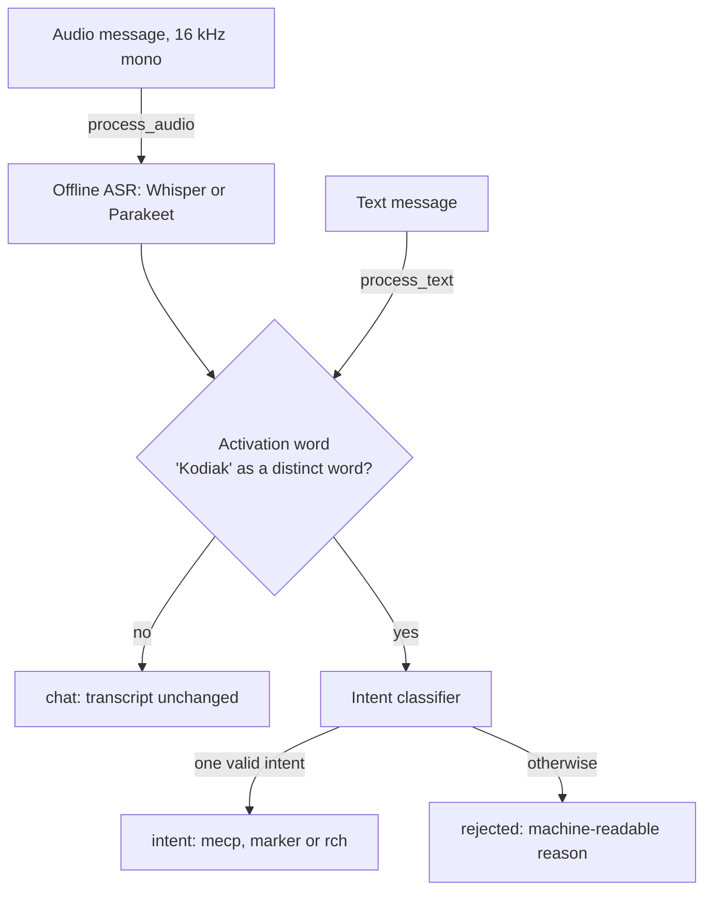

# R3AKT Kodiak in Sigil

Kodiak is a reusable, offline voice-command engine. Sigil passes it each received voice clip and acts on what comes back. Kodiak lives in this workspace for now as three independent packages; [KODIAK_EXTRACTION.md](../KODIAK_EXTRACTION.md) explains how they move to `FreeTAKTeam/R3AKT-Kodiak`.

## Processing sequence



Kodiak transcribes, gates and classifies. It never executes commands, publishes messages, reads hardware, or invents positions, headings or confidence values. The caller decides what to do with each result.

`process_text` enters the sequence at the activation-word check. RCH can use it to interpret text that arrives from ordinary LXMF clients.

## Packages

| Package | Depends on | Features | Role |
|---|---|---|---|
| `kodiak-core` | `serde`, `serde_json` | none | `KodiakResult` contract, `WakeWord`, `Engine`, `Transcriber` and `IntentClassifier` traits |
| `kodiak-asr` | `kodiak-core` | `whisper` (default), `parakeet` | Recognizers taken from Sigil's former `transcription.rs` |
| `kodiak-intent` | `kodiak-core`, `serde`, `toml` | none | Vocabularies, `DeterministicClassifier`, datasets, examples |
| `kodiak-laya` | `kodiak-core`, `kodiak-intent`, `laya-candle` | none | Optional `LayaClassifier` (`laya/1`), the `evaluate_laya` and `probe` examples. Built only with Sigil's `laya` feature. Binaries that include it are GPLv3-or-later (see its `NOTICE`). |

Text-only use needs only `kodiak-core` and `kodiak-intent`, and loads no speech model. `Engine::with_transcriber_loader` loads the speech model on the first audio message. One `Engine` is `Send + Sync`, and Sigil shares a single engine, and so a single loaded model, across every radio it hears.

The API is synchronous. Recognition and classification are CPU-bound and Sigil runs them on its ASR worker thread; async callers should use a blocking thread pool.

## Result contract `kodiak.result.v1`

Every result carries `"schema": "kodiak.result.v1"` and a `type`.

```json
{"schema":"kodiak.result.v1","type":"chat","content":"We need more food at the camp."}

{"schema":"kodiak.result.v1","type":"intent","category":"mecp","intent":"mecp.report",
 "data":{"severity":1,"code":"S02","content":"MECP/1/S02"},
 "transcript":"Kodiak. Urgent. Need Food.","classifier":"deterministic/3"}

{"schema":"kodiak.result.v1","type":"intent","category":"marker","intent":"contact.report",
 "data":{"affiliation":"hostile","direction_type":"relative_clock","relative_bearing_deg":105,"distance_m":200},
 "transcript":"Kodiak hostile three thirty two hundred meters.","classifier":"deterministic/3"}

{"schema":"kodiak.result.v1","type":"intent","category":"rch","intent":"mission.users","data":{},
 "transcript":"Kodiak list users.","classifier":"deterministic/3"}

{"schema":"kodiak.result.v1","type":"rejected","reason":"no_intent","detail":"no intent recognized",
 "transcript":"Kodiak launch the missiles","classifier":"deterministic/3"}
```

- **Rejection reasons:** `no_intent`, `ambiguous`, `missing_parameter`, `invalid_parameter` and `unsupported_command`.
- **Contact directions:** a contact report has either `direction_type: relative_clock` with `relative_bearing_deg` (12 o'clock is 0°, and half hours add 15°), or `direction_type: compass_bearing` with `bearing_deg`.
- **Optional contact fields:** `classification`, `quantity` and `activity`.
- **Corrections:** an intent or rejection lists every transcribed word that was read as a different vocabulary word, for example `"corrections":[{"heard":"meet","read_as":"need"}]`. The field is omitted when every word matched exactly.
- **Confidence:** only a classifier that produces a calibrated probability reports `confidence` (for example `laya/2`). `deterministic/3` never does, and Kodiak never invents one.
- **Misheard activation word:** a classifier may judge that a transcript without the activation word still addresses Kodiak (`IntentClassifier::addressed`). The removed word is then listed first in `corrections`, read as `kodiak`. `deterministic/3` accepts a first word within edit distance 3 of "kodiak" (4 letters or more, such as "Kardiac", "Podax" or "Codeac"), but only when the rest of the transcript is a recognized command; otherwise the transcript stays chat.
- **Strict decoding:** an unknown schema version, or an intent whose category doesn't match, fails to decode.

## Vocabularies (version 1)

The vocabulary files are in `crates/kodiak-intent/vocabularies/`, embedded at compile time and validated when loaded.

- **MECP (`mecp/v1.toml`).**
  - Contains the 4 severities and all 108 event codes shared by REM (`apps/mobile/src/utils/mecp.ts`) and RCH (`crates/r3akt-profile-rch/src/lib.rs`).
  - Kodiak adds only spoken phrases; it doesn't redefine any code.
  - A report needs exactly one severity word (mayday, urgent, safety, routine) and exactly one event. Spoken variants heard on the radio are also accepted: "may day" and "may they" for mayday, "normal" for routine.
  - R03 accepts minutes and H07 accepts a head count, encoded as REM and RCH do (`MECP/2/R03 15`, `MECP/2/H07 12pax`).
  - B04 is left out because it exists in REM only; RCH reports it as unknown.
- **Contact (`contact/v1.toml`).**
  - **Affiliation:** friendly, hostile, neutral, unknown or suspect.
  - **Direction:** a clock position (whole and half hours, spoken or written as `3:30` or `330`), a bearing (`bearing two seven zero`, `bearing 45 degrees`) or an 8-point compass direction.
  - **Distance:** in metres or kilometres, up to 100 km.
  - **Optional details:** classification, quantity and activity (`moving north`).
- **RCH (`rch/v1.toml`).**
  - Intent names are RCH's canonical dispatcher names: `help`, `mission.join`, `mission.leave`, `mission.pause`, `mission.resume`, `mission.nick` (with `nickname`), `mission.users`, `mission.registry.mission.list`, `mission.marker.list`, `mission.events.list`, `mission.registry.eam.list`, `checklist.list.active`, `mission.time` ("mission time remaining", the latest mission) and `mission.library.list` ("list library", or "search mission library for <words>" with `search`).
  - A command must match a phrase completely.
  - The names were checked against RCH's `main` at commit `0a71f4b` (20 November 2026), which added `mission.time` (`13284db`) and `mission.library.list` (`e0dba68`).
  - A request that RCH does not provide can be listed as `[[unsupported]]` and is then rejected as `unsupported_command`. None are listed at present.

Classification order: a complete RCH command phrase first, then an MECP severity word, then a contact affiliation. A severity word together with an affiliation is `ambiguous`. Any word the grammar still doesn't recognize after correction causes a rejection, never a guess.

## Fuzzy matching

Live NFM tests showed that the recognizer spells the same spoken command differently on each pass: "May Day", "may they", "Maydays", and "meet" for "need". Before the strict grammar runs, `kodiak-intent` corrects words that no vocabulary contains:

1. **What may change.** A word is a candidate only if it is unknown to every vocabulary, has at least four letters, and contains no digits. Known words, numbers and short words are never changed.
2. **Sound-aware distance.** The word is compared with every vocabulary word by edit distance. Swapping letters that sound alike over radio costs half an edit: m/n, t/d, p/b, k/g/c/q, s/z/c, f/v, and any two vowels.
3. **One clear winner.** The word is replaced only if one vocabulary word is strictly closest, within one edit for words of up to six letters and one and a half edits for longer words.
4. **Second chance for leftover MECP words.** A known word that no MECP phrase used may be read as an MECP filler word if it clearly sounds like one. "meet" (from the phrase "meet at") becomes "need". Fillers carry no meaning, so this can only drop a misheard word; it can never add an action.
5. **Protected words.** Negations and cancellations (`not`, `no`, `never`, `don`, `cannot`, `cancel`, `stop`, `ignore` and others) are never corrected and never used as targets. "Kodiak mayday we don't need water anymore" is still rejected.
6. **Audit trail.** Every replacement is listed in the result's `corrections`, saved in the transcript and gateway events, and logged by Sigil as `Kodiak read "meet" as "need"`.

Multi-word and plural severity spellings ("may day", "may they", "maydays") are also accepted. Free-text arguments such as a nickname or a library search keep the words as transcribed.

## Intent model status

**laya (21 November 2026):** `crates/kodiak-laya` puts a laya-candle typed-decision model behind `IntentClassifier`. Its second design (`laya/2`) matches the rules on the evaluation set and adds one paraphrased hub command, but no live radio case beyond `deterministic/3`, so it is off by default. The numbers and reasons are in [kodiak-laya-benchmark.md](kodiak-laya-benchmark.md).

The deterministic classifier with fuzzy correction (`deterministic/3`) is the shipped baseline. Research on 21 November 2026 found the following about "Intent-SLM":

- **No downloadable weights.** The only matching project is `piyush9786/Intent-SLM` on GitHub. It is MIT-licensed and based on `microsoft/MiniLM-L12-H384-uncased`, which is also MIT. Its repository holds a tokenizer and configuration files, but no ONNX or safetensors weights.
- **Wrong labels.** Its intent head is trained on the 7 SNIPS intents (music, weather and so on), so it cannot recognize R3AKT commands without retraining.
- **Closest usable alternative:** `sentence-transformers/all-MiniLM-L6-v2` (Apache-2.0). It publishes ONNX files, including INT8 versions of about 23 MB, plus `tokenizer.json`. Its embeddings could feed a small classifier trained on Kodiak's dataset.

Kodiak is ready for a model without depending on one:

- **Replaceable classifier.** `IntentClassifier` is the replacement point. A model adapter returns the same typed intents, and must validate its parameters with the vocabulary parsers before returning an intent.
- **Training data.** `cargo run -p kodiak-intent --example generate_dataset` writes about 1,000 labelled utterances generated from the vocabularies.
- **Held-out evaluation.** `crates/kodiak-intent/datasets/eval.v1.jsonl` is a hand-written evaluation set of 94 utterances, including rejections, recognizer misspellings and the live NFM transcripts.
- **Runtime choice.** For Rust inference, use the `ort` crate with `load-dynamic`. Point it at the `onnxruntime.dll` that Sherpa-ONNX already ships. Two different ONNX Runtime versions cannot load in one Windows process.

## Sigil integration

1. The ASR worker passes each completed voice clip to `Engine::process_audio`. BSS decoding continues in parallel.
2. The transcript JSON gains a `kodiak` field, and the `sdr.gateway.v1` transcript event gains `kodiak` and `position` fields. Both additions are optional, so older events still load.
3. Correlation attributes the transcript to the trailing BSS ID, exactly as before. The attributed packet's GPS fix becomes the event's current position.
4. The publisher resolves the radio's identity and calls `intents::plan` (`src/intents.rs`), which picks one of four outcomes:

| Kodiak result | Published to RCH from the radio's own LXMF identity |
|---|---|
| chat, or no Kodiak result | Chat message, as before (`[rch].send_chat`) |
| `mecp.report` | Field 9 `mission.registry.log_entry.upsert`, with `content` = `MECP/<s>/<code> <lat>,<lon>` |
| `contact.report` | Field 9 `mission.marker.create` at the computed contact position, with an affiliation symbol and a repeatable `object_destination_hash` |
| RCH command | Field 9 `{"command_type": <intent>, "args": {...}, "command_id": <event id>}`. RCH's dispatcher and authorization decide what happens. |
| rejected | Nothing is sent. The journal records `ignored` and the reason. |

- **Position rule:** the publisher uses the current BSS fix if there is one, otherwise the radio's last valid fix from the identity registry. If the radio has never sent a fix, MECP and contact reports are ignored locally. RCH commands don't need a position.
- **Heading rule:** a clock direction is added to the radio's compass heading. BSS reports a `heading_deg` whose meaning is unverified; it may be GPS course over ground. It is used only when `[kodiak].bss_heading_is_compass = true`. Otherwise clock-direction reports are ignored locally with a logged reason. A spoken compass bearing needs only a position.
- **Contact position:** computed with the great-circle destination formula on a spherical Earth.
- **Intent switch:** `[rch].send_intents` turns intent publishing on or off. The gateway stays receive-only and sends no acknowledgement or voice feedback to the radio.

## Verification (21 November 2026, Windows x64)

| # | Requirement | Evidence | Result |
|---|---|---|---|
| 1 | Kodiak packages build on their own | Extraction rehearsal: 15 tests pass in a standalone workspace (see KODIAK_EXTRACTION.md) | Pass |
| 2 | Text runs without loading ASR | `kodiak-core` `text_never_loads_asr_and_one_shared_model_serves_every_caller` | Pass |
| 3 | Speech without the wake word is chat | Synthesized "We need more food at the camp." and three real radio recordings, with both backends | Pass |
| 4 | Speech with Kodiak is classified | Five synthesized commands, with both backends (table below) | Pass |
| 5 | MECP uses canonical codes | Evaluation set; every one of the 108 codes reachable; spec examples S02, S01, M06, R07 | Pass |
| 6 | Contact bearings and distances | Evaluation set: clock, half hour, digits, bearings, compass points, units | Pass |
| 7 | RCH command names | Evaluation set; Reticulum loopback test receives field 9 `mission.users` with the event ID | Pass |
| 8 | Unknown and incomplete commands rejected | Evaluation set: 24 rejection cases (`no_intent`, `ambiguous`, `missing_parameter`, `invalid_parameter`), including negation | Pass |
| 9 | No Sigil imports in Kodiak | `tests/kodiak_isolation.rs`; `cargo tree` of the extracted workspace | Pass |
| 10 | Existing SDR, BSS and LXMF behaviour | All 14 earlier Sigil tests pass, including the loopback chat and telemetry test. Live RF session (below): tuning, squelch, capture, BSS decoding and attribution worked. RCH publishing was not enabled. | Pass |
| 11 | One engine shared by every radio | Four threads share one engine and the model loader runs once; Sigil builds one engine per process | Pass |

The workspace has 39 tests, and `cargo clippy --workspace --all-targets` (pedantic) is clean.

### Speech to intent

The clips were synthesized with Windows text-to-speech at 16 kHz and run through `kodiak-asr`'s `bench` example. Model load time is excluded from the per-clip times.

| Clip | Parakeet TDT v2 INT8 | Whisper base.en |
|---|---|---|
| "Kodiak. Urgent. Need food." | `MECP/1/S02`, 596 ms | `MECP/1/S02`, 3,980 ms |
| "Kodiak. Hostile. Three thirty. Two hundred meters." | contact 105°, 200 m, 824 ms | contact 105°, 200 m, 4,299 ms |
| "Kodiak. List users." | `mission.users`, 461 ms | `mission.users`, 4,336 ms |
| "We need more food at the camp." | chat, 507 ms | chat, 4,266 ms |
| "Kodiak. Mayday. Severe bleeding." | `MECP/0/M06`, 888 ms | `MECP/0/M06`, 3,859 ms |
| "Kodiak. Safety. All clear." | `MECP/2/R07`, 752 ms | `MECP/2/R07`, 4,454 ms |
| Three real radio clips (3.3–6.3 s) | chat, 515–791 ms | chat, 3,727–4,461 ms |

- **Model load:** Parakeet 4.5 s, Whisper base 0.24 s.
- **Real-time factor:** Parakeet 0.12–0.19; Whisper 0.6–1.6.
- **Text classification:** about 6–8 µs per utterance at the median. An utterance with several unknown words takes up to about 2.5 ms, because each one is compared with the whole vocabulary. Building the engine and validating all vocabularies takes about 2 ms.

The first run of these clips found two failures:

- Both recognizers wrote "hostile" as "Hostel" and "three thirty" as "330".
- Whisper wrote "Kodiak" as "Codeiac" once.

The contact vocabulary now accepts "hostel", the clock parser accepts `330`/`1030`, and the default wake word accepts the observed spellings. All six commands then passed with both backends.

### Live RF test

The receiver ran with Parakeet and BSS decoding on 435.9950 MHz. A VR-N76 sent the transmissions below; RCH publishing was off.

| Spoken | Parakeet transcript | Result |
|---|---|---|
| A radio check without "Kodiak" | "Just as a radio check, the water is clear." | chat |
| "We need more water at the camp." | as spoken; attributed to CORVO by its BSS ID | chat |
| "Kodiak. Mayday, need water." (first try) | "Kodiak May Day needs water." | rejected before the fixes; now `MECP/0/S01` |
| Same clip, replayed from its WAV | "Kodiak may they need water" | `MECP/0/S01` |
| "Kodiak. Mayday, need water." (second try) | "Kodiak Maydays need water." | rejected before the fixes; now `MECP/0/S01` with `maydays` read as `mayday` |
| Same clip, replayed from its WAV | "Kodiak Mayday meet water." | `MECP/0/S01` with `meet` read as `need` |

The same audio produced different transcripts on each pass, which is why fuzzy matching was added rather than more fixed spellings. All recordings are kept in `transcripts/kodiak-test`, and every one now gives the expected result.

Two radio-side findings from this session:

- **Speech without a BSS ID** can be published from a separate "Unidentified radio" identity (`[identity].unidentified_sender`); its MECP and contact reports are still ignored because that identity has no position.
- **Lost BSS frames: USB sample drops.** On 21 November many BSS frames from both radios failed, at any gain and distance, while voice still transcribed. Every failed frame had sharp discriminator spikes at the same point in Sigil's 20 ms processing blocks (samples 182–184 of 640, the DSP delay after a block boundary); no good frame had any. Sigil read the dongle and processed each block on one thread, so the dongle's small buffer overflowed whenever processing or the operating system delayed the next read. The lost samples shortened AFSK bits. Voice tolerates that; 1,200-baud data does not. The receiver now reads USB on a dedicated thread in 128 ms transfers and queues up to about 4 s for processing, logging any drop instead of losing samples silently. Live retest at 16.6 dB gain: all 7 bursts sent, three from Corvo and four from BLACKY (including its periodic beacon), decoded with GPS positions. The decoded frames contain no spikes, and BLACKY's bit-timing jitter fell from 2.8–5.1 samples to 1.5, the same as Corvo's.
- **Hub end to end (21 November 2026, 17:38).** With the USB fix, the gateway published to RCH hub `c4de0286…50a4` over Reticulum. All attributed items were confirmed by transport proof and shown by RCH: Corvo's chat ×2 and its `MECP/0/S01` report with position, BLACKY's chat, and positions from both radios, each from the radio's own identity. Two BLACKY transcripts were not attributed: one was ambiguous with Corvo's beacon 1 s later, and in the other a single noise block after its packet extended the speech. Both causes were fixed afterwards: a packet inside the speaker's own carrier now takes precedence, and speech resumes only after 100 ms of audio. Those fixes are covered by tests but not yet re-run on air.
- **Delayed BSS burst:** in the third session the VR-N76 sent its BSS packet, now with GPS (43.96733° N, 66.12593° W, 20 m), as a separate burst about 1.1 s after the voice. The fixed 300 ms trailing gap rejected it, so the gap is now configurable (`[processing].trailing_id_gap_ms`). A later session measured about 2.4 s, so the default is 3 s.

The third session also passed live: both radio checks stayed chat, and both "Kodiak. Mayday, need water." transmissions gave `MECP/0/S01` with no corrections needed.

## Limitations

- **The command grammar is strict.** After fuzzy correction, any word the grammar still does not recognize rejects the whole command. That is safe, but natural phrasing outside the vocabularies is not understood until a model is added. Example: "multiple casualties at the bridge" is rejected because of "at the bridge".
- **Fuzzy matching can pick the wrong word.** It reads an unknown word as the closest-sounding vocabulary word. "deed" is read as "dead", for example; in "mayday deed water" that made the report ambiguous, so it was rejected. Check `corrections` when auditing a command.
- **Live RF testing is limited.** One session with one radio and one speaker (above). Recognition accuracy across voices, noise levels and weak signals is not yet measured.
- **Recognizer spellings add false-activation risk.** Treating "hostel", "codeiac" and similar spellings as Kodiak words lets an ordinary sentence trigger a command. The activation word still has to come first.
- **Clock directions are off by default.** They need `bss_heading_is_compass = true`, and nobody has verified whether the VR-N76 BSS heading is a compass heading.
- **Spoken bearings are treated as true north.** No magnetic declination correction is applied.
- **Command replies never reach the operator.** RCH replies to commands (for example the user list) go to the radio's LXMF identity, which the receive-only gateway never reads. `checklist.list.active` sends no reply at all on success. These commands change state in RCH or appear in its logs, but the operator hears nothing back.
- **BSS IDs can be spoofed.** BSS is unauthenticated, so anyone who transmits an allowlisted radio ID can issue RCH commands as that radio's identity. RCH's `authorization_required` setting is off by default, so RCH executes every supported command. Before enabling intents on a live hub, turn on RCH capability checks for these identities, or set `[rch].send_intents = false`.
- **Not tested against a running RCH.** The MECP log-entry and marker messages follow RCH's command handlers as read from the RCH source at commit `c2bf78a`, and RCH command names were rechecked against `main` at `0a71f4b`; no live RCH instance received them. The REM-to-RCH MECP path appears unsupported in that RCH version, so Sigil sends the full `command_type` envelope instead.
- **Suspect contacts get the `unknown` symbol**, because RCH's symbol catalog has no suspect symbol.
- **The legacy Python publisher (`send_lxmf.py`) ignores Kodiak.** It still sends every live transcript as chat, including spoken commands.
- **Whisper base is near real time on this CPU** (about 4 s per clip). Prefer Parakeet when commands must reach RCH quickly.
